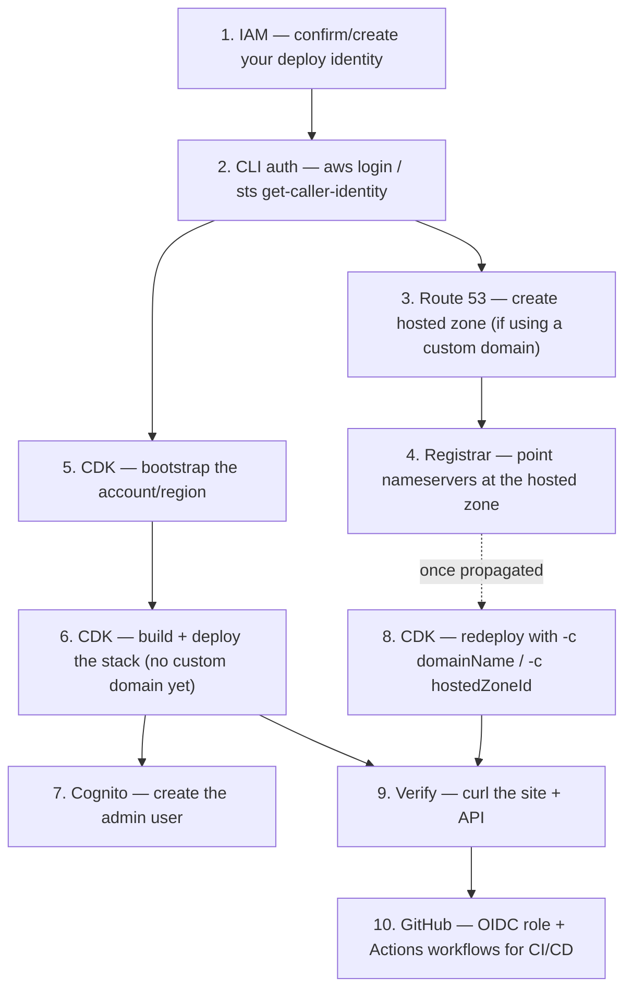

# BrainSplinters.com — Deployment Plan

This document is a step-by-step AWS walkthrough, broken down by service/tool,
in the order you actually need to touch them to go from "builds and tests pass
locally" to "live on brainsplinters.com," plus automated deploys via GitHub
Actions. It assumes the app code itself is already implemented (see
[README.md](README.md) for day-to-day developer commands).

Everywhere there's an AWS CLI command, use it instead of the console — it's
faster, scriptable, and leaves a record of exactly what was run. The console
is only needed for a couple of one-off interactive things (initial `aws login`
browser flow, viewing things visually if you want to double check).

**Guiding principle:** same as PLANNING.md — keep this boring. One AWS account,
one region, one CDK stack (`BrainSplintersStack`), one GitHub Actions pipeline.

## Order of operations



Steps 3–4 (DNS) and step 8 (custom domain redeploy) can happen in parallel
with everything else, since DNS propagation takes time — don't block on it.

## 1. IAM — identity for deploying

You need one IAM identity (user or SSO role) with enough permissions to
create everything CDK provisions (DynamoDB, Lambda, API Gateway, Cognito, S3,
CloudFront, Route 53, ACM, plus IAM roles/policies for the Lambdas
themselves). For a single personal project, attaching the AWS-managed
`AdministratorAccess` policy to your user/role is the pragmatic choice —
scoping it down further has little benefit here and a lot of maintenance cost.

Check what you currently have:

```bash
aws sts get-caller-identity
aws iam list-attached-user-policies --user-name <your-iam-username>
aws iam list-groups-for-user --user-name <your-iam-username>
```

If nothing is attached, either attach the policy directly or (cleaner) put the
user in an admin group:

```bash
aws iam create-group --group-name Admin
aws iam attach-group-policy --group-name Admin \
  --policy-arn arn:aws:iam::aws:policy/AdministratorAccess
aws iam add-user-to-group --group-name Admin --user-name <your-iam-username>
```

## 2. AWS CLI authentication

Confirm the CLI is actually authenticated as that identity (not expired, not
accidentally root):

```bash
aws sts get-caller-identity
```

If you get a session-expired error, re-authenticate (the exact flow depends on
how your CLI is configured — SSO, `aws login`, or static keys). If you're
using a shared account, double check you're not signing in as the **root**
user for day-to-day CLI/CDK work — use a dedicated IAM user/role instead.

## 3. Route 53 — hosted zone for your domain (skip if no custom domain yet)

Create a public hosted zone for the domain. This is what CDK will later use
both for ACM certificate DNS validation and for the final A records:

```bash
aws route53 create-hosted-zone \
  --name brainsplinters.com \
  --caller-reference "brainsplinters-$(date +%s)" \
  --hosted-zone-config Comment="BrainSplinters.com production"
```

The response includes a `HostedZone.Id` (strip the `/hostedzone/` prefix —
you want just the trailing ID, e.g. `Z0123456789EXAMPLE`) and a
`DelegationSet.NameServers` array with 4 name server values. Save both.

## 4. Domain registrar — point nameservers at Route 53 (skip if no custom domain yet)

This is the one step that can't be done via AWS CLI, because it happens at
whichever registrar sold you the domain (GoDaddy, Namecheap, Route 53
Registrar, etc.), not in AWS. In that registrar's DNS/nameserver settings,
replace the existing nameservers with the 4 values from step 3.

Check propagation from the command line (can take minutes to ~48 hours):

```bash
dig +short NS brainsplinters.com
```

Once this returns the `awsdns-*` nameservers from step 3, you're ready for
step 8. Everything else below doesn't depend on this finishing.

## 5. AWS CDK — bootstrap the account/region

One-time per AWS account + region. This creates the S3 bucket and IAM roles
CDK uses to stage and deploy assets:

```bash
cd packages/infrastructure
npx cdk bootstrap aws://<ACCOUNT_ID>/<REGION>
```

You can get `<ACCOUNT_ID>` from `aws sts get-caller-identity`. Pick one region
for everything (DynamoDB, Lambda, API Gateway, Cognito) — CloudFront itself is
global regardless of the stack's region, and the CDK stack already requests
the ACM certificate in `us-east-1` internally when a custom domain is used, no
matter what region you bootstrap/deploy the main stack in.

## 6. Build + first CDK deploy (no custom domain yet)

Build the app, then deploy the stack without the `domainName`/`hostedZoneId`
context so the site goes live immediately on the default CloudFront domain,
without waiting on DNS:

```bash
npm install
npm run build        # builds shared -> api -> web; CDK packages apps/web/dist and packages/api/src

cd packages/infrastructure
npx cdk deploy --require-approval never
```

This provisions, in one shot: DynamoDB table, Cognito user pool + client, 10
Lambda functions, the HTTP API (API Gateway), the private S3 bucket, and the
CloudFront distribution. Expect this to take a few minutes — CloudFront
distributions are the slow part.

Record the stack outputs printed at the end:

```
BrainSplintersStack.ApiUrl = https://xxxxxxxxxx.execute-api.<region>.amazonaws.com
BrainSplintersStack.SiteUrl = https://xxxxxxxxxx.cloudfront.net
BrainSplintersStack.DistributionId = EXXXXXXXXXXXXX
BrainSplintersStack.TableName = BrainSplintersStack-TableXXXXXXXX-XXXXXXXXXXXXX
BrainSplintersStack.UserPoolId = <region>_XXXXXXXXX
BrainSplintersStack.UserPoolClientId = xxxxxxxxxxxxxxxxxxxxxxxxxx
```

You can always re-fetch these later without redeploying:

```bash
aws cloudformation describe-stacks --stack-name BrainSplintersStack \
  --query "Stacks[0].Outputs"
```

## 7. Cognito — create the admin user

There's no public sign-up; the one admin account is created directly via CLI,
using the `UserPoolId` output from step 6:

```bash
aws cognito-idp admin-create-user \
  --user-pool-id <UserPoolId> \
  --username you@example.com \
  --user-attributes Name=email,Value=you@example.com Name=email_verified,Value=true \
  --temporary-password "<some-temporary-password>"
```

The user is created in `FORCE_CHANGE_PASSWORD` status. Visit the site's
`/admin` path and sign in with that email + temporary password — the app
handles the forced password-reset challenge on first login.

## 8. CDK — redeploy with the custom domain (once DNS has propagated)

Once `dig +short NS brainsplinters.com` (step 4) shows the Route 53
nameservers, redeploy with the domain context added. This adds an ACM
certificate (DNS-validated automatically against the hosted zone) and Route 53
A records for both the apex and `www`:

```bash
npm run build   # if anything changed since step 6
cd packages/infrastructure
npx cdk deploy --require-approval never \
  -c domainName=brainsplinters.com \
  -c hostedZoneId=<hosted zone ID from step 3>
```

This redeploy updates the existing CloudFront distribution in place (adds
alternate domain names + certificate) rather than creating a new one, so the
`DistributionId` and other outputs stay the same except `SiteUrl`, which will
now reflect the custom domain.

## 9. Verify end-to-end

```bash
curl -s -o /dev/null -w "%{http_code}\n" https://brainsplinters.com/           # homepage, expect 200
curl -s -o /dev/null -w "%{http_code}\n" https://brainsplinters.com/admin      # admin shell, expect 200
curl -s https://<ApiUrl>/splinters                                            # public API, expect []
```

Then fill in `apps/web/.env.local` (copy from `.env.example`) with the
`ApiUrl`/`UserPoolId`/`UserPoolClientId` outputs so local dev (`npm run dev`)
talks to the real deployed API, and log into `/admin` to confirm the Cognito
user from step 7 works end to end (including setting a permanent password).

## 10. CI/CD via GitHub Actions

Goal: every push to `main` that passes build/test/lint automatically deploys
to AWS. Pull requests only run build/test/lint (no deploy, no AWS credentials
needed).

### 10.1 IAM — OIDC trust for GitHub Actions (no long-lived keys)

Avoid storing AWS access keys as GitHub secrets. Instead, create an IAM OIDC
identity provider plus a role that GitHub Actions can assume temporarily.

**a. Create the OIDC identity provider** (skip if your account already has one
for `token.actions.githubusercontent.com` — check first):

```bash
aws iam list-open-id-connect-providers

# only if none exists for GitHub already:
aws iam create-open-id-connect-provider \
  --url https://token.actions.githubusercontent.com \
  --client-id-list sts.amazonaws.com \
  --thumbprint-list 6938fd4d98bab03faadb97b34396831e3780aea1
```

**b. Create the trust policy file**, scoped to this repo's `main` branch:

```bash
cat > /tmp/github-trust-policy.json <<'EOF'
{
  "Version": "2012-10-17",
  "Statement": [
    {
      "Effect": "Allow",
      "Principal": {
        "Federated": "arn:aws:iam::<ACCOUNT_ID>:oidc-provider/token.actions.githubusercontent.com"
      },
      "Action": "sts:AssumeRoleWithWebIdentity",
      "Condition": {
        "StringEquals": {
          "token.actions.githubusercontent.com:aud": "sts.amazonaws.com"
        },
        "StringLike": {
          "token.actions.githubusercontent.com:sub": "repo:<github-org>/<repo-name>:ref:refs/heads/main"
        }
      }
    }
  ]
}
EOF
```

**c. Create the role and attach permissions.** `AdministratorAccess` is the
pragmatic choice here (CDK needs to create IAM roles, Cognito pools,
CloudFront distributions, etc.) for a single-stack personal project:

```bash
aws iam create-role \
  --role-name brainsplinters-github-deploy \
  --assume-role-policy-document file:///tmp/github-trust-policy.json

aws iam attach-role-policy \
  --role-name brainsplinters-github-deploy \
  --policy-arn arn:aws:iam::aws:policy/AdministratorAccess

aws iam get-role --role-name brainsplinters-github-deploy --query 'Role.Arn' --output text
```

**d. Store the role ARN and region as GitHub repository variables** (not
secrets — the role ARN isn't sensitive on its own since the trust policy
restricts who can assume it). If you have the GitHub CLI installed and
authenticated (`gh auth login`), this is scriptable too:

```bash
gh variable set AWS_DEPLOY_ROLE_ARN --body "arn:aws:iam::<ACCOUNT_ID>:role/brainsplinters-github-deploy"
gh variable set AWS_REGION --body "<REGION>"
gh variable set DOMAIN_NAME --body "brainsplinters.com"
gh variable set HOSTED_ZONE_ID --body "<hosted zone ID from step 3>"
```

Otherwise, set the same 4 variables under the repo's Settings → Secrets and
variables → Actions → Variables tab in the GitHub web UI.

### 10.2 Workflow: pull requests (build, test, lint only)

`.github/workflows/ci.yml`:

```yaml
name: CI

on:
  pull_request:
  push:
    branches: [main]

jobs:
  build-test-lint:
    runs-on: ubuntu-latest
    steps:
      - uses: actions/checkout@v4
      - uses: actions/setup-node@v4
        with:
          node-version: 20
          cache: npm
      - run: npm ci
      - run: npm run lint
      - run: npm run build
      - run: npm test
```

This runs on every PR and also on pushes to `main` (so `main` itself is always
verified), with no AWS credentials involved.

### 10.3 Workflow: deploy on push to `main`

`.github/workflows/deploy.yml`, triggered after CI succeeds on `main` (or as a
second job in the same workflow — shown here as a separate workflow gated on
the CI workflow's success):

```yaml
name: Deploy

on:
  workflow_run:
    workflows: [CI]
    types: [completed]
    branches: [main]

permissions:
  id-token: write   # required for OIDC
  contents: read

jobs:
  deploy:
    if: github.event.workflow_run.conclusion == 'success'
    runs-on: ubuntu-latest
    steps:
      - uses: actions/checkout@v4
        with:
          ref: main

      - uses: actions/setup-node@v4
        with:
          node-version: 20
          cache: npm

      - run: npm ci
      - run: npm run build

      - uses: aws-actions/configure-aws-credentials@v4
        with:
          role-to-assume: ${{ vars.AWS_DEPLOY_ROLE_ARN }}
          aws-region: ${{ vars.AWS_REGION }}

      - name: cdk deploy
        working-directory: packages/infrastructure
        run: |
          npx cdk deploy --require-approval never \
            -c domainName=${{ vars.DOMAIN_NAME }} \
            -c hostedZoneId=${{ vars.HOSTED_ZONE_ID }}
```

Notes:

- `--require-approval never` is required since there's no interactive
  terminal in CI; this is safe here because the PR-gated CI workflow already
  verified the build, and there's only one environment.
- If `DOMAIN_NAME`/`HOSTED_ZONE_ID` repository variables are unset, the `-c`
  flags resolve to empty strings; `bin/infrastructure.ts` treats empty/unset
  context the same way as omitted, so the stack still deploys fine without a
  custom domain.
- `npm run build` already rebuilds `apps/web/dist`, which `BucketDeployment`
  in the CDK stack uploads to S3 as part of `cdk deploy`.
- Using `workflow_run` keeps "deploy" strictly dependent on "CI passed",
  without re-running the build/test/lint steps a second time. A simpler
  alternative is to combine both into one workflow with two sequential jobs
  (`test` then `deploy`, with `needs: test`) if you prefer a single YAML file.

### 10.4 What CI/CD intentionally does not do

- No staging/preview environments — this is a single personal site with one
  environment. If that changes later, consider a second CDK stack instance
  (e.g. `BrainSplintersStack-staging`) deployed from pull request branches.
- No manual approval gate on deploy — pushes to `main` deploy automatically.
  If you want a manual gate, use a GitHub Actions
  [environment](https://docs.github.com/actions/deployment/targeting-different-environments/using-environments-for-deployment)
  with required reviewers on the `deploy` job.
- No rollback automation — CloudFormation will roll back automatically on a
  failed deploy; for a bad deploy that "succeeds" but is behaviorally wrong,
  revert the commit on `main` and let the pipeline redeploy the previous state.

## 11. Operational checklist after each deploy

- Hit `SiteUrl` (or the custom domain) and confirm the homepage loads.
- Hit `/splinter/<existing-id>` and confirm it renders (validates the
  CloudFront Function rewrite still works post-deploy).
- Log into `/admin` and confirm authentication still works (validates the
  Cognito pool/client weren't replaced — CDK updates in place unless a
  property requiring replacement changed).
- Check CloudWatch Logs for the Lambda functions if anything looks off.

## 12. Destroying the stack

Not expected to be needed in normal operation, but if you ever need to tear
everything down:

```bash
cd packages/infrastructure
npx cdk destroy
```

The DynamoDB table and Cognito user pool are created with `RemovalPolicy.RETAIN`
(see PLANNING.md section 11), so they will **not** be deleted automatically —
remove them manually afterward if you really want a full teardown.
